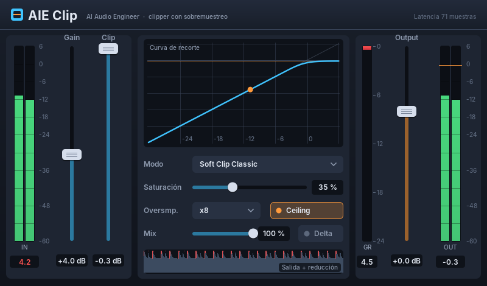

# AIE Clip — clipper VST2 (estilo StandardCLIP)

Plugin VST 2.4 propio, sin el SDK de Steinberg (la interfaz binaria está escrita a mano en `aieclip.cpp`).
Se compila en GitHub Actions para Windows de 32 bits (Cubase 5) y de 64 bits y se publica en la
página de descargas como `AIEClip-32bits.dll` / `AIEClip-64bits.dll`.

## Interfaz propia (1.2)
Se dibuja por software (`gui.h`, letras Inter rasterizadas en `gui_font.h` con `tools/gen_font.py`; Inter tiene
licencia SIL Open Font License 1.1) y en Windows se copia a una ventana hija de la que da Cubase.
- Medidores de entrada y salida (pico), reducción (GR) y lecturas de pico máximo (clic para reiniciar).
- Gráfica de la curva de recorte con el nivel actual; historial de salida y reducción.
- Mandos: arrastrar (Mayúsculas o Ctrl = ajuste fino), doble clic = valor por defecto, rueda del ratón.
- `tools/preview.cpp` renderiza la interfaz a imagen en Linux; `tests_gui.cpp` prueba ratón, menús y dibujo.

## Parámetros
| Parámetro | Rango | Qué hace |
|---|---|---|
| Gain | -12 … +24 dB | ganancia antes del clipper (empuja la señal contra el umbral) |
| Clip | -24 … 0 dB (por defecto -0,3) | umbral/techo del clipper |
| Saturación | 0 … 100 % (30 %) | anchura de la rodilla (0 = recorte duro en Classic y Pro) |
| Modo | Soft Clip Classic, Soft Clip Pro, Hard Clip, Ratio 2:1 | forma de la curva (ver abajo) |
| Oversampling | x1, x2, x4, x8, x16, x32 (x4) | sobremuestreo para reducir el aliasing del recorte |
| Output | -24 … +12 dB | ganancia final |
| Mix | 0 … 100 % | mezcla en paralelo (la señal seca va retrasada igual que la procesada) |
| Ceiling | Off/On | recorte duro final al umbral para que ningún pico lo supere |
| Delta | Off/On | escuchar solo lo que el clipper quita (para ajustar Gain de oído) |

Modos (curvas propias, no copiadas de ningún otro plugin):
- **Soft Clip Classic**: rodilla tanh; se acerca al techo de forma progresiva (más color).
- **Soft Clip Pro**: rodilla cuadrática que llega justo al techo (más transparente).
- **Hard Clip**: recorte duro.
- **Ratio 2:1**: por encima de la rodilla reduce a la mitad hasta llegar al techo (más suave, tipo compresor).

Latencia: siempre 71 muestras (1,6 ms a 44,1 kHz), también a 1x; se comunica al anfitrión con
`initialDelay` y Cubase la compensa. Es fija a propósito: cambiar OverSmp durante la reproducción no obliga a
Cubase a reiniciar el plugin, y los filtros se calculan al cargarlo (el hilo de audio no reserva memoria).

## Sobremuestreo
Cascada de etapas x2 con filtros de media banda de fase lineal (Kaiser, ~90 dB de rechazo). La primera etapa
tiene 123 coeficientes y deja pasar hasta 20 kHz a 44,1 kHz; las siguientes (25, 17, 17, 33) son cortas porque
trabajan a más frecuencia.

Medidas (las comprueba `test_host` en cada compilación, a 48 kHz):
| OverSmp | respuesta 10–20 kHz | aliasing, recorte duro 6 dB a 6,3 kHz | aliasing con Soft 30 % |
|---|---|---|---|
| 2x | -0,000 dB | -39,7 dB | -48,4 dB |
| 4x | -0,002 dB | -52,8 dB | -69,9 dB |
| 8x | -0,002 dB | -64,4 dB | -98,1 dB |
| 16x | -0,003 dB | -75,9 dB | -118,6 dB |
| 32x | -0,003 dB | -86,9 dB | -123,9 dB |

La versión 1.0 perdía 5 dB a 18 kHz y 12,7 dB a 20 kHz con sobremuestreo; la prueba de respuesta lo detecta.
El aliasing con recorte duro depende sobre todo del factor (los armónicos del recorte duro bajan muy despacio);
con Soft cae mucho más rápido.

## Instalar en Cubase 5 (32 bits)
1. Descarga `AIEClip-32bits.dll`.
2. Cópialo en la carpeta de plugins VST de Cubase (normalmente
   `C:\Program Files (x86)\Steinberg\Cubase 5\VSTPlugins`) y renómbralo a `AIEClip.dll`.
3. Abre Cubase: aparece en la lista de insertos como **AIE Clip** (si no, Dispositivos →
   Información de plug-ins → Actualizar).

## Compilar y probar a mano
- Windows (Developer Command Prompt):
  `cl /O2 /EHsc /MT /LD aieclip.cpp /link /DEF:aieclip.def /OUT:AIEClip.dll` y
  `cl /O2 test_host.c && test_host.exe AIEClip.dll`
- Linux: `g++ -O2 -shared -fPIC aieclip.cpp -o libaieclip.so && gcc test_host.c -o th -ldl -lm && ./th ./libaieclip.so`

`test_host.c` es un anfitrión mínimo que comprueba exportaciones, parámetros, que ningún pico supere el
techo con cada sobremuestreo y que una señal por debajo del techo sale intacta y alineada con la latencia.
