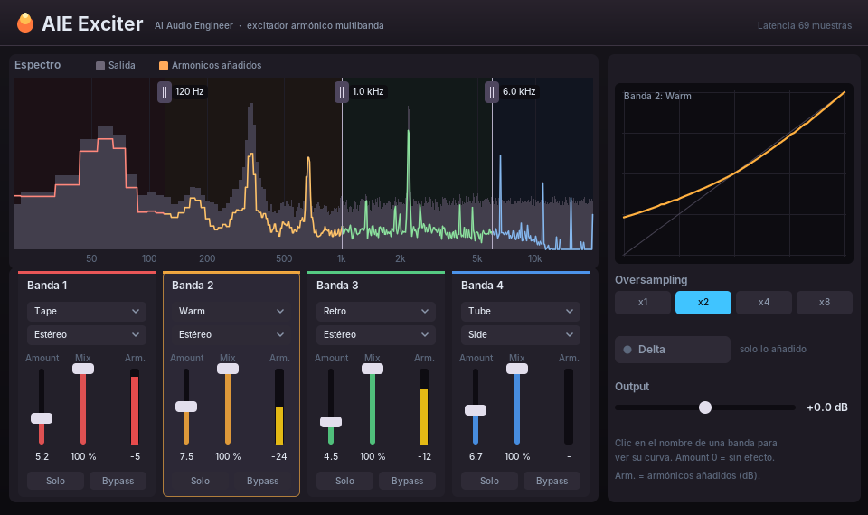

# AIE Exciter — excitador armónico multibanda (estilo Ozone Exciter)

Plugin VST 2.4 de 4 bandas que añade armónicos (calidez, brillo, presencia, "pegamento").

## Por banda
| Control | Qué hace |
|---|---|
| Perfil | Tube, Tape, Retro, Warm, Triode, Dual Triode (medidos en Ozone 7 Exciter) y Warm Tape (Warm + Tape) |
| Modo | Estéreo · Mid (solo el centro) · Side (solo los lados) · Transient (solo los ataques) · Sustain (solo el cuerpo) |
| Amount | 0 a 15, la misma escala que Ozone: 0 = sin efecto, 5 = moderado, 15 = máximo |
| Mix | seco/húmedo (saturación paralela) |
| Solo / Bypass | escuchar solo la banda / dejarla limpia |
| Arm. | medidor de armónicos añadidos respecto a la banda (dB) |

Global: cortes arrastrables sobre el espectro (salida en gris y armónicos añadidos en color), Oversampling
x1/x2/x4/x8, Delta (escuchar solo lo añadido), Output, y la curva de la banda seleccionada (clic en su nombre).

## Cómo funciona
- Bandas con cruces Linkwitz-Riley de 4.º orden con compensación de fase (suma plana).
- **Curvas medidas en Ozone 7** (renders del usuario a Amount 5 y 15, senos a 4 niveles; ver
  `herramientas/medicion_ozone/generar_curvas.py`):
  - Tube, Retro y Warm son en Ozone una curva fija seguida de un paso alto (15 Hz). AIE Exciter usa esa misma
    curva y el mismo filtro; Amount empuja la señal contra la curva (de 5 a 15: +36 dB en Tube, +10 dB en
    Retro, +24 dB en Warm). Ganancia y armónicos coinciden con Ozone a menos de 0,1 dB / 1,5 dB.
  - Tape, Triode y Dual Triode tienen memoria en Ozone (histéresis de cinta, polarización que se mueve con el
    nivel) y no se pueden copiar con una curva fija. Se usa una curva suave ajustada a la ganancia y los
    armónicos de Ozone (`ajustar_armonicos.py`): a Amount 5 coinciden casi exactos; a Amount 15 los armónicos
    quedan cerca, pero en pasajes flojos Triode y Dual Triode suben 3-4 dB menos que Ozone.
- Como en Ozone, la saturación depende del nivel: un pasaje fuerte satura más y, con mucho Amount, los picos
  bajan y lo flojo sube (Tube a 15: +7 dB a -24 dBFS, -17 dB a 0 dBFS). Usa Mix y Output para compensar.
- Sobremuestreo con las mismas etapas de media banda que AIE Clip; latencia fija de 69 muestras (Cubase la
  compensa) con cualquier factor. Retro a 15 con un seno de 7 kHz: aliasing -32 dB a x1, -77 dB a x8.
- CPU medida (Linux x86, 4 bandas activas): ~2,4 % de un núcleo a x2, ~4,7 % a x8.

## Pruebas
`tests_exciter.cpp` (compara con las medidas de Ozone a -24, -12 y -6 dBFS, más Delta, Mix 0, Mid/Side, Transient/Sustain, ratón y velocidad) y
`test_exciter_host.c` (lo carga como Cubase y en Windows abre la ventana real).
