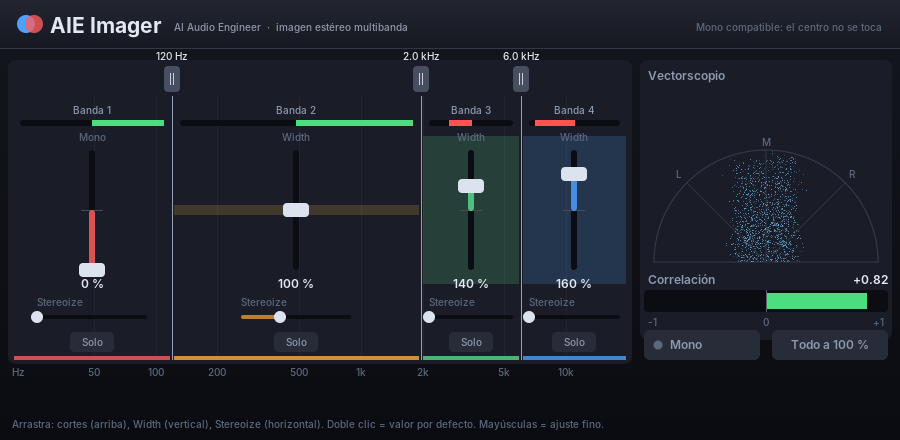

# AIE Imager — imagen estéreo multibanda (estilo Ozone Imager)

Plugin VST 2.4 de 4 bandas para controlar la anchura estéreo por frecuencias, sin latencia.

## Cómo funciona
- Trabaja en **Mid/Side**. Solo se cambia la parte lateral (Side) de cada banda; el centro (Mid) recibe los
  mismos filtros pero no se modifica, así que **la suma mono es la misma con cualquier ajuste**.
- Bandas con un árbol de cruces Linkwitz-Riley de 4.º orden con compensación de fase: con todo al 100 % cada
  frecuencia sale al mismo nivel (desviación < 0,05 dB medida) y con la misma imagen estéreo.

## Controles
| Control | Qué hace |
|---|---|
| Cortes (asas de arriba) | frecuencias entre bandas (por defecto 120 Hz, 1 kHz, 6 kHz); se ordenan solos |
| Width (vertical, por banda) | 0 % = banda en mono · 100 % = sin cambios · 200 % = doble de anchura |
| Stereoize (horizontal) | abre en estéreo una banda mono añadiendo al lateral una copia retrasada de su centro (7–13 ms según la banda); no cambia la suma mono |
| Solo | escuchar solo esa banda (se pueden combinar) |
| Mono | escuchar la mezcla en mono para comprobar |
| Todo a 100 % | deja todas las bandas sin cambios |

Medidores: correlación por banda (barra de colores de cada banda: verde = compatible, rojo = fase opuesta),
anchura medida (bloque translúcido), vectorscopio (mono = línea vertical) y correlación total.

Uso típico en EDM: banda 1 (graves) a 0 % para un bajo mono y firme; bandas 3–4 a 120–150 % para abrir
sintes y aire; Stereoize suave en medios si un sinte mono suena estrecho.

## Pruebas
- `tests_imager.cpp`: nivel plano con todo al 100 %, sin latencia, suma mono intacta con ajustes extremos,
  Width 0 % deja la banda en mono, Width 200 % duplica el lateral, Stereoize abre una banda mono sin cambiar
  la suma mono, Solo aísla la banda, Mono, cortes cruzados, ratón y velocidad de dibujo.
- `test_imager_host.c`: lo carga como Cubase; en Windows abre la ventana real, hace clic y la captura.
