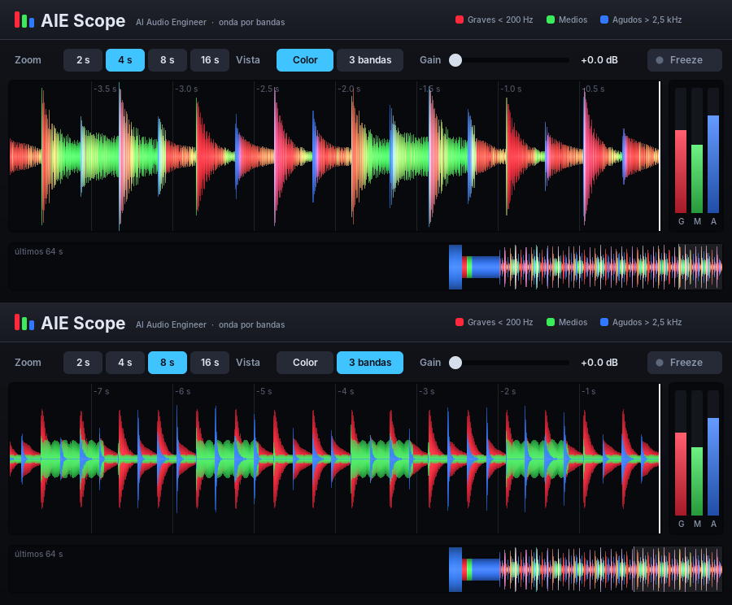

# AIE Scope — onda en color por bandas (estilo programas de DJ)

Plugin VST 2.4 de análisis: **no modifica el sonido** (salida = entrada, sin latencia) y dibuja en tiempo real
la forma de onda coloreada por bandas:

- **Rojo**: graves (< 200 Hz) · **Verde**: medios (200 Hz – 2,5 kHz) · **Azul**: agudos (> 2,5 kHz)
- Las bandas se separan con filtros Linkwitz-Riley de 4.º orden; cada ~3 ms se guarda el pico de la señal y de
  cada banda (búfer de ~95 s).

## Controles
| Control | Qué hace |
|---|---|
| Zoom 2 / 4 / 8 / 16 s | tiempo visible en la onda principal (también con la rueda del ratón sobre la onda) |
| Vista Color / 3 bandas | Color: una sola onda con el color mezclado de las bandas. 3 bandas: tres ondas superpuestas |
| Gain | escala vertical (0 a +24 dB) para ver bien pistas flojas; doble clic = 0 dB |
| Freeze | congela la imagen (también con clic sobre la onda) |

Abajo, la franja "últimos 64 s" resume el último minuto; el recuadro claro marca lo que se ve arriba. A la
derecha, medidores de nivel de cada banda (G, M, A).

## Instalar en Cubase 5 (32 bits)
Descarga `AIEScope-32bits.dll`, cópialo en la carpeta VSTPlugins de Cubase con el nombre `AIEScope.dll` y
ponlo como inserto (por ejemplo en el master, al final de la cadena).

## Pruebas
- `tests_scope.cpp`: el sonido no cambia, 80 Hz / 900 Hz / 7 kHz caen en su banda, ~345 columnas por segundo
  a 44,1 y 48 kHz, dibujo rápido, botones/rueda/Freeze/Gain; con un argumento guarda vistas previas.
- `test_scope_host.c`: lo carga como Cubase; en Windows abre la ventana real, hace clic y la captura.
